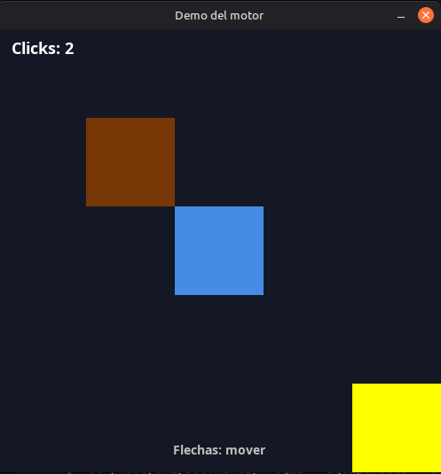
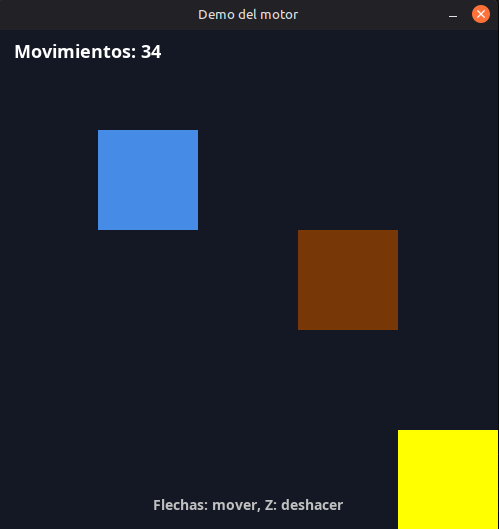
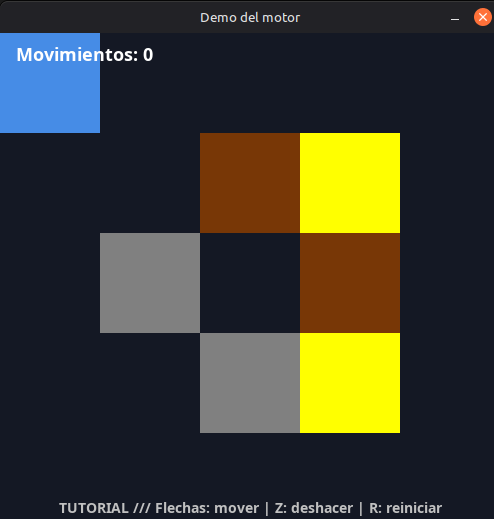
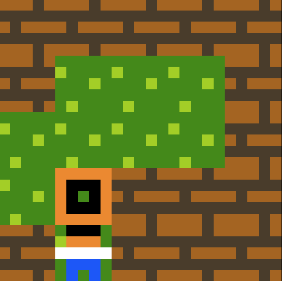
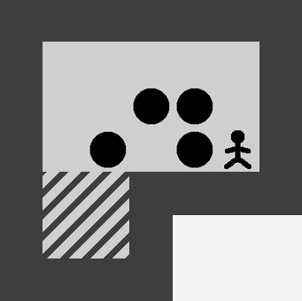
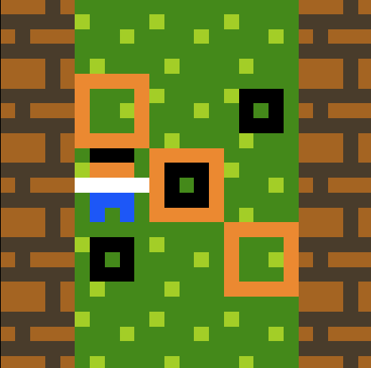
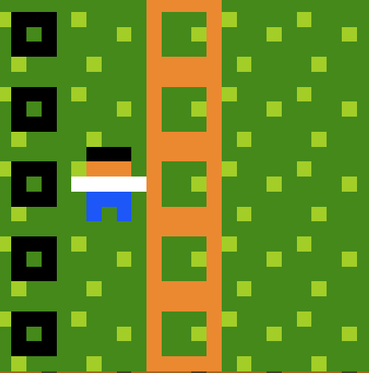
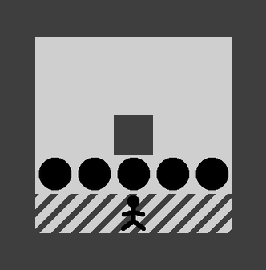

# Devlog:

En la clase del viernes 30-10, recibimos el motor hecho en Java junto con una demo. Junto con la consigna y todos los juegos posibles.

Elegimos hacer un juego tipo Sokoban:

1) Jugador es un redondo azul, puede moverse en celdas 5*5
2) Cajas son cuadrados marrones, pueden ser empujados
3) Meta es un cuadrado amarillo que parpadea

Jugador empuja la caja desde arriba, abajo, izquierda, derecha.
Debe empujar la caja hasta la meta.
Jugador puede deshacer movimientos con Z.

Mínimo 3 niveles.

---

Primero experimentamos con la demo: cambiamos los colores, el tamaño del cuadrado, el tamaño de la ventana desde el *Main.java*, y miramos cada archivo para ver qué hacía (si no entendíamos algo, le pedíamos a ChatGPT que nos lo explicara facil).

Gracias a las pruebas entendimos mejor el motor.

Hay algunos archivos que por alguna razón nos dan errores en rojo, pero nos permiten igual ejecutar el juego, sin problema aparente.

Por ahora, a esos archivos los vamos a dejar todo comentados con " // "
(cada uno tiene una aclaración en su nombre).

Si después los necesitamos, intentaremos arreglar esos errores primero.

---

Íbamos a hacer el juego desde 0, pero se nos hizo más facil hacerlo a partir de la demo, por lo que vamos a ir eliminando y agregando cosas en base a lo que necesitemos.

Eventualmente, se va a convertir en *Tutorial.java*.

Para hacer el sokoban, elegimos una cuadricula 5*5.

Para ello, hicimos la ventana de tamaño: 500px * 500px.

Cada cuadro sería 100px.

Después creamos un cuadrado (azul) para el personaje, otro (marrón) para la caja, y otro (amarillo) para la meta.

Cambiamos también el texto.

(todavía nos quedaban retazos de código, como los clicks)

Reutilizamos el código de visible/!visible para la meta, de esa forma puede titilar y diferenciarse de los demás cuadrados. Aparte, hicimos que la meta se dibuje antes que la caja y el jugador, para que estos últimos se superpongan.

---

En *Entrada.java* están los métodos:

- estaPresionada(int codigo)
- fuePresionada(int codigo)

La demo usaba el primero, pero preferimos usar el segundo, porque queríamos que el jugador pueda moverse "a saltos": si presionas a la derecha, que el cuadro azul se mueva instantaneamente un cuadro a la derecha.

El jugador aparece en el centro. Si se presiona a la derecha, se mueve 100px a la derecha (lo mismo con las demás direcciones). Siempre que haya un espacio libre en esa dirección.

El jugador también tiene que poder mover la caja desde uno de los lados. Siempre que haya un espacio libre en esa dirección.

Para ello: creamos las variables jugadorX, jugadorY; cajaX, cajaY; metaX, metaY.

Con eso, podemos saber la posición concreta de cada uno.

Si el jugador quiere mover la caja a la derecha, primero comprueba si hay espacio libre en esa dirección. Si hay, aumenta cajaX y JugadorX en 100.

Hicimos prototipos rápidos de los métodos, y luego le pedimos a ChatGPT que lo reordenase y mejorase la legibilidad. Si no sabíamos bien cómo hacer algo específico, le préguntábamos cómo lo haría, y lo implementábamos nosotros.

---

31-10

Antes de poder hacer los niveles, queremos resolver el tema más complicado: poder rebobinar con la letra Z.

Idea de Medina Martínez Emiliano: cada que ocurre un nuevo movimiento, se crea un nuevo objeto de tipo Movimiento. Dentro de movimiento, se guarda jugadorX, jugadorY, cajaX y cajaY.

Cuando se presiona la Z, cambiamos las coordenadas por las del último objeto, y a ese último objeto, lo eliminamos.

Para ello, vamos a crear *Rebobinar.java* dentro de la carpeta *demo*.

No podemos usar ArrayList, asi que crearemos uno propio.
En la carpeta *estructuras* ya existe una *Pila.java*, entonces voy a hacer *PilaEnlazada.java*, que implementa Pila.

---

Con ya todo esto, ya tenemos un prototipo jugable.

Añadimos también un texto "Ganaste", se va a mostrar solo cuando la caja llegue a la meta.
Luego con Enter, se avanzará al siguiente nivel (escena).

---

01-11

    Me olvidé de ir publicando los avances en github, voy a ir subiendolos.

Queremos hacer ahora una escena que sea el nivel 1 (el primero funciona como tutorial).

Para ello, vamos a crear más de una caja, y también vamos a crear una pared que no podremos mover. Va a ser de color gris.

Decidimos dividirlos en sus propias entidades: caja, jugador, pared y meta, todos serán sus correspondientes clases.

Esta vez sí le pedimos a la IA que lo haga por nosotros, porque iba a ser tardado.
Pero por culpa de eso, el código del *Tutorial.java* (que antes era *demo.java*) se hizo demasiado largo.
Si fuera un proyecto importante, revisaría el código y lo intentaría hacer más corto, pero es para el jueves (aparte, tenemos un parcial que estudiar), entonces lo dejaremos así.

Así quedó el tutorial:

---

Después queremos replicar estos niveles, que encontramos en internet y que no son demasiado fáciles, hay que pensarlas para resolverlo.

Nivel 1:

Nivel 2:

Nivel 3:

Nivel 4:

Nivel 5 (final):

---

Nos dimos cuenta de una cosa: la IA, cuando le pedimos que mejorase el código, cambió las estructuras por ArrayList. Por eso, le pedimos a la IA que lo refactorice de nuevo, teniendo en cuenta lo que pedía el enunciado (no ArrayList, utilizar listas propias). De paso, nos ayudó con la herencia y polimorfismo que nos faltaba:

- Creamos *Movible.java* (interfaz para que las cajas y el jugador puedan moverse).
- Creamos *ColaEnlazada<T>*, *ListaEnlazada<T>* y *PilaEnlazada<T>* (cada uno implementa su interfaz correspondiente).
- Refactorizamos practicamente todos los códigos de la carpeta *demo*, para poder hacer los niveles más facilmente.

De paso ya creamos el menú y la pantalla final.

Ahora sí, solo nos faltan crear los 5 niveles, en la carpeta *demo/niveles*.